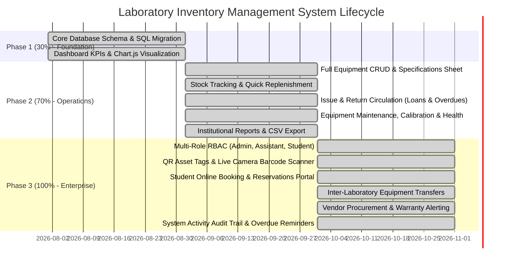
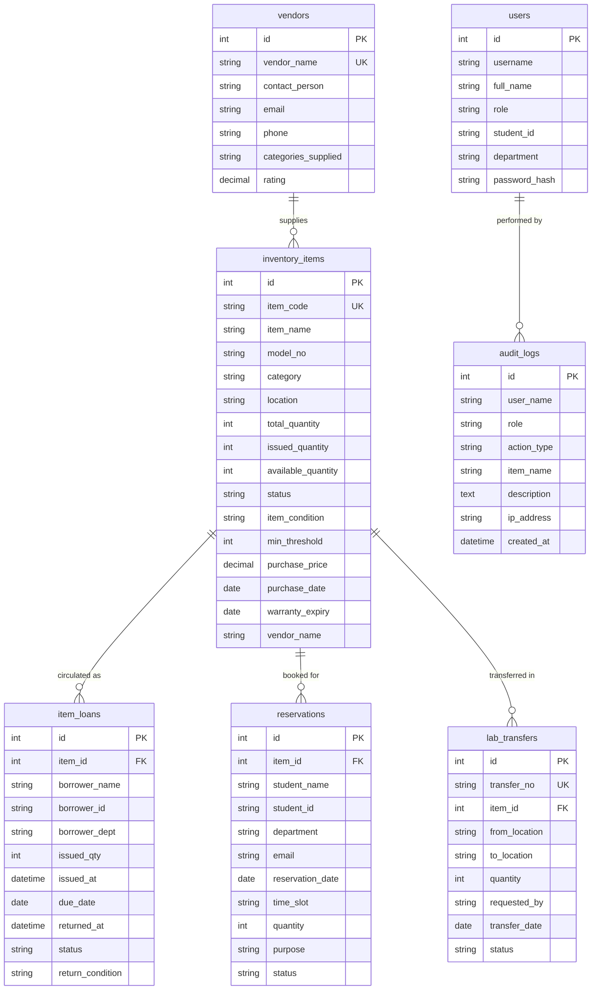

# 🔬 Lab Inventory Management System – Complete Project Walkthrough & Technical Reference

> **Milestone Status:** **Phase 3 (100% Complete) – Production Ready**  
> **Repository:** `lab-inventory`  
> **Tech Stack:** HTML5, Vanilla CSS3 (Dark/Emerald Modern Theme), JavaScript (ES6+), PHP 8 (MySQLi), MariaDB / MySQL 10.4+, Chart.js, QRCode.js, HTML5-QRCode  

---

## 📌 Executive Summary

The **Laboratory Inventory Management System** is a complete, enterprise-grade laboratory apparatus and chemical tracking suite designed for academic colleges, engineering polytechnics, and research laboratories. 

The project has achieved **100% completion** across all three planned phases:
- **Phase 1 (30%):** Core database schema, equipment listing, responsive dashboard layout, and category distribution charts.
- **Phase 2 (70%):** Full equipment CRUD management, stock replenishment, issue & return circulation workflows, overdue alerting, condition tracking, maintenance logs, and printable report generation.
- **Phase 3 (100%):** Role-Based Access Control (RBAC) with 3 institutional profiles, Printable QR Code Asset Stickers, Live Camera Barcode/QR Scanner, Student Online Booking & Reservation Portal, Inter-Laboratory Multi-Room Transfers, Vendor Directory & Warranty Tracking, and an Immutable Activity Audit Trail.

---

## 📊 Complete Milestone Lifecycle (30% ➔ 70% ➔ 100%)

---

## 🔐 Multi-Role Access Control & Institutional Personas

The system enforces strict permission boundaries based on user roles:

| Persona | Username | Default Password | Granted Privileges & Capabilities |
| :--- | :--- | :--- | :--- |
| **Administrator** (Lab In-Charge) | `admin` | `admin123` | Full control: create, edit, delete equipment, register vendors, clear audit trail, approve/reject transfers and reservations, manage system settings. |
| **Lab Assistant** (Technician) | `assistant` | `assist123` | Operational authority: issue & return equipment, inspect return condition, schedule maintenance tickets, dispatch & receive lab transfers, approve student reservations. Cannot delete equipment or wipe audit logs. |
| **Student / Researcher** | `student` | `student123` | Self-service access: browse equipment specifications, check real-time availability, book advance reservation slots, view personal loan status. |

---

## 🚀 Phase 3 Features (100% Completion Suite)

### 1. Role-Based Access Control (RBAC) & Fast Role Switcher
- Real-time role switching via topbar dropdown for instant testing of all personas.
- Sensitive actions (`.admin-only` and `.staff-only`) dynamically hide or show based on the active role.
- All administrative and circulation actions log the operating user, role, and client IP address to the audit trail.

### 2. QR Code / Barcode Suite (Generation & Scanning)
- **Printable QR Asset Label:** 
  - Every apparatus generates an institutional asset tag containing equipment code, name, model, room location, and a scannable high-contrast 2D QR barcode.
  - Dedicated print styling (`window.print()`) formats individual labels to standard sticker dimensions.
- **HTML5 Camera QR & Barcode Scanner:**
  - Integrated camera scanner powered by `html5-qrcode`.
  - Scans physical tags via laptop webcam or mobile camera.
  - Features asset detection preview card with 1-click actions: **Issue Item**, **Return Item**, or **View Specifications**.
  - Manual item code fallback lookup input for testing without a physical camera.

### 3. Student Online Booking & Reservation Portal
- Students can reserve equipment slots in advance for upcoming practical sessions or research experiments.
- Includes time slot selection (Morning: 09:00–12:00, Afternoon: 12:00–02:00, Evening: 02:00–05:00).
- Live stock meter prevents overbooking past available quantity.
- Staff approval queue: technicians can approve, reject, or convert an approved reservation into an active loan with 1 click.

### 4. Multi-Laboratory Inter-Room Transfers
- Track equipment movements between campus labs (e.g., Electronics Lab ➔ Advanced Computing Lab).
- Automatic origin room detection based on current equipment location.
- Multi-state custody flow: **Pending Dispatch ➔ In Transit ➔ Received & Verified**.
- Accepting custody automatically updates the apparatus's permanent location in the inventory master table.

### 5. Vendors, Procurement & Warranty Tracking
- Directory of equipment suppliers, contact persons, phone numbers, and ratings.
- Asset valuation metrics: real-time computation of total inventory capital value.
- **Automated Warranty Monitor:** Flags equipment with warranties expiring within 30 days or already expired, with warning badges and days remaining count.

### 6. Security Activity Audit Trail & Overdue Reminders
- Chronological, tamper-evident log recording all actions: `ITEM_CREATED`, `ITEM_UPDATED`, `ITEM_DELETED`, `ITEM_RESTOCK`, `ITEM_ISSUED`, `ITEM_RETURNED`, `MAINTENANCE_CREATED`, `TRANSFER_REQUEST`, `TRANSFER_RECEIVED`, `RESERVATION_CREATED`, `LOGIN`.
- Multi-criteria filtering by action type, user, apparatus, or date.
- 1-click **Export Audit CSV** spreadsheet generation.
- **Automated Overdue Notice Generator:** Compiles list of unreturned items with overdue days count, ready-to-copy institutional reminder template, and email notification simulation.

---

## 🗄️ Database Architecture & Migration

The system features self-healing auto-migration (`ensure_phase3_schema($conn)` in `db.php`). Upon launching the application, all necessary tables and columns are automatically created if missing:

---

## 🔌 Complete REST API Reference

All backend APIs are built in PHP 8 using MySQLi prepared statements and output strict JSON (`Content-Type: application/json; charset=utf-8`):

| Endpoint | Method | Key Parameters | Purpose |
| :--- | :--- | :--- | :--- |
| `auth.php?action=login` | POST | `username`, `password` | Authenticate user, start session |
| `auth.php?action=check` | GET | &mdash; | Verify current login session |
| `auth.php?action=logout` | GET | &mdash; | Terminate user session |
| `auth.php?action=quick_switch` | GET | `role` | Fast-switch user persona |
| `fetch_statistics.php` | GET | &mdash; | Returns all dashboard and Phase 3 KPIs |
| `fetch_items.php` | GET | `search`, `category`, `status`, `condition` | Filtered equipment catalog |
| `add_item.php` | POST | Equipment fields + procurement fields | Inserts new apparatus record |
| `update_item.php` | POST | `id`, updated equipment fields | Updates existing apparatus record |
| `delete_item.php` | POST | `id` | Deletes apparatus (loan protected) |
| `restock_item.php` | POST | `item_id`, `add_qty`, `notes` | Quick stock replenishment |
| `issue_item.php` | POST | `item_id`, `borrower_name`, `qty`, `due_date` | Creates active circulation loan |
| `return_item.php` | POST | `issue_id`, `condition`, `remarks` | Restores stock & logs return inspection |
| `maintenance_api.php` | GET/POST | Ticket details, status, cost | Schedules or completes maintenance |
| `reservations_api.php` | GET/POST | `action=list`, `create`, `update_status`, `convert_to_loan` | Student booking operations |
| `transfers_api.php` | GET/POST | `action=list`, `create`, `dispatch`, `receive` | Inter-laboratory transfers |
| `vendors_api.php` | GET/POST | `action=list`, `create`, `update`, `delete` | Supplier directory & warranties |
| `audit_api.php` | GET/POST | `action=list`, `action_type`, `search`, `clear` | Activity audit trail retrieval |

---

## 🖥️ Step-by-Step Verification Guide

1. **Sign In:**
   - Open `http://localhost/lab-inventory/` in your browser.
   - Click the **Admin Profile** shortcut (or type `admin` / `admin123`) and click **Sign In**.
2. **Test QR Asset Tags & Camera Scanner:**
   - Open **[http://localhost/lab-inventory/test_qr.html](http://localhost/lab-inventory/test_qr.html)** to view pre-generated testing QR tags for multimeters, oscilloscopes, and glassware.
   - In the **Inventory** tab, click the **QR Tag** button on any equipment item to generate and print custom asset stickers.
   - Click **Scan QR Code** in the topbar to launch the live camera scanner, or enter `EQ-EL-001` in the manual input to simulate instant tag detection.
3. **Test Student Online Reservations:**
   - Switch role to **Student** using the topbar profile dropdown.
   - Click **Bookings & Reservations** in the sidebar.
   - Click **Book Equipment Slot**, choose an oscilloscope, set tomorrow's date, and submit.
   - Switch role back to **Lab Assistant** or **Admin** &rarr; click **Approve** &rarr; click **Issue Apparatus** to convert it directly into an active loan.
4. **Test Inter-Lab Transfers:**
   - Navigate to **Lab Transfers** in the sidebar.
   - Click **Request Lab Transfer**, select an apparatus, set a destination room, and submit.
   - Click **Dispatch**, then click **Receive & Verify**. Notice how the equipment's location automatically updates in the main inventory table!
5. **Test Vendors & Warranties:**
   - Navigate to **Vendors** in the sidebar.
   - Review the total valuation metric (₹), active vendors, and the warranty expiration warning table.
6. **Inspect the Activity Audit Trail:**
   - Click **Audit Trail** in the sidebar.
   - Every single item addition, loan issue, return inspection, and transfer is recorded with timestamps, user names, roles, and details.
   - Click **Export Audit CSV** to download the spreadsheet report.
7. **Configure System Settings & Preferences:**
   - Click **Settings** in the sidebar.
   - **Campus & Lab Info:** Customize Institution Name, Department, Lab Room, and In-Charge email.
   - **Circulation Policies:** Set default loan period (days), max items per student, and low-stock threshold alert level.
   - **Display & Themes:** Switch between Forest Green, Navy Blue, and Emerald themes, change currency representation (₹, $, €, £), and date formats.
   - **Backup & Diagnostics:** Export full JSON database backups or download spreadsheets.
   - Click **Save Changes** — preferences persist automatically in browser local storage.

---

*Laboratory Inventory Management System – 100% Phase 3 Production Ready with Full Settings Hub & Symmetrical Responsive Alignment.*

