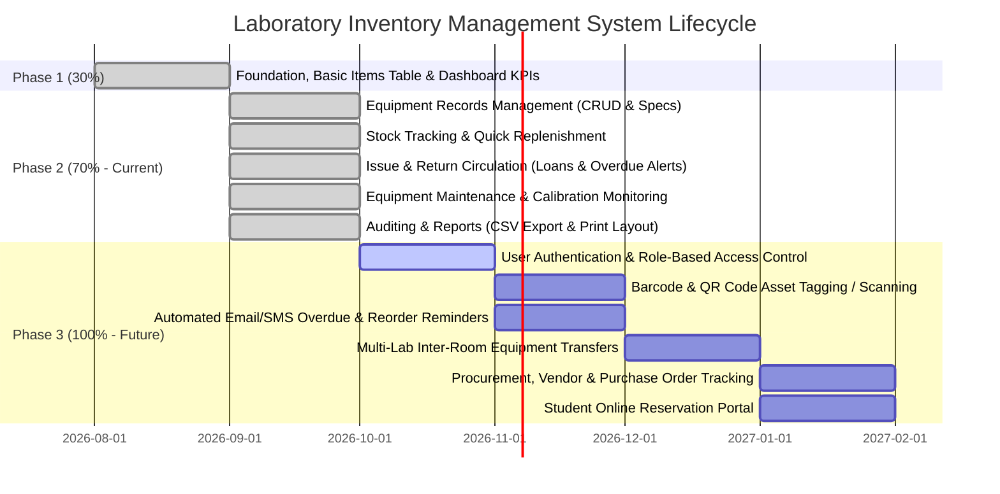
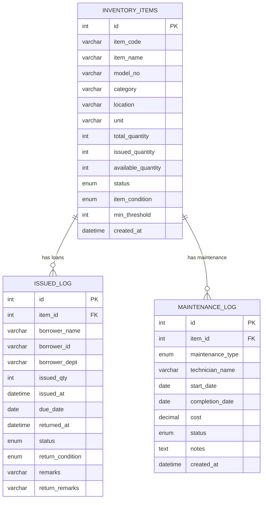

# 🔬 Lab Inventory Management System – Project Walkthrough & Development Roadmap

> **Milestone Status:** Phase 2 Completed &mdash; **70% Overall Progress**  
> **Repository:** `lab-inventory`  
> **Tech Stack:** HTML5, Vanilla CSS3 (Custom Design System), JavaScript (ES6+), PHP 8 (MySQLi), MySQL / MariaDB, Chart.js  

---

## 📌 Executive Summary

This walkthrough document outlines:
1. **The Evolution from 30% to 70% Completion:** What was initially built vs. what has just been implemented.
2. **Current Features (70% Implementation):** Full breakdown of Equipment Records, Stock Tracking, Issue & Return, Maintenance & Calibration, and Reports & Analytics.
3. **Operational User Guide:** Step-by-step instructions on how to use each feature.
4. **Backend & Database Reference:** Database schema, triggers, and JSON REST API endpoints.
5. **Phase 3 Roadmap (Next 30% to reach 100%):** Detailed specifications for future updates to guide upcoming development.

---

## 📊 Milestone Progression (30% &rarr; 70% &rarr; 100%)



---

## 🛠️ What Was Built (Phase 1 vs. Phase 2)

| Feature Area | Phase 1 (30% - Previous) | Phase 2 (70% - Now Implemented) |
| :--- | :--- | :--- |
| **Dashboard** | 4 basic counter cards, category bar chart, stock doughnut chart | 5 KPI cards (Total Equipment, Available Units, Active Loans, Low Stock, Under Maintenance), live Overdue banner, Top Borrowed equipment table |
| **Equipment Records** | Basic item name and category only; no edit or delete | Full equipment records: Equipment Code (Tag), Model/Serial No., Room/Rack Location, Unit, Condition (New/Good/Fair/Needs Maint./Under Repair), Min Threshold |
| **Inventory Actions** | 1-click single-unit issue only | Full CRUD: Add Equipment modal, Edit Details modal, Quick Restock modal, View Specifications Sheet modal, Delete with active loan protection |
| **Stock Tracking** | Static status check based on &le; 3 units | Configurable `min_threshold` per item, real-time availability sync (`available = total - issued`), quick replenishment with notes |
| **Issue & Return** | *Placeholder ("Coming Soon")* | **Full Module Enabled:** Active Loans tab, Overdue tracking with live days calculation, Borrower name/ID/Dept, Due date, Return modal with condition inspection |
| **Maintenance** | *Not present* | **Full Module Enabled:** Service tickets (Repair, Calibration, Inspection, Preventive Maint.), Technician/Vendor, Cost, Status, Auto-updates item condition |
| **Reports** | *Placeholder ("Coming Soon")* | **Full Module Enabled:** 4 Report types, dynamic KPI metrics, Category & Condition charts, CSV Spreadsheet Export, Institutional Print/PDF Layout |

---

## 🔍 Feature Deep Dive (The 70% Deliverables)

### 1. Equipment Records Management
Laboratories can track scientific apparatus, chemicals, and glassware with high specificity:
- **Unique Asset Code:** Auto-generated or custom tag (e.g., `EQ-EL-001`, `GW-CH-002`).
- **Model / Serial Number:** For calibration tracking and warranty reference (e.g., *Fluke 87V*, *Rigol DS1054Z*).
- **Precise Laboratory Location:** Track which room, bench, rack, shelf, or cabinet houses the equipment (e.g., `Room 201 - Bench B2`).
- **Operational Condition:** Categorized into `New`, `Good`, `Fair`, `Needs Maintenance`, or `Under Repair`.
- **Multi-Criteria Filter:** Search by name, category, condition, status, and location simultaneously.

### 2. Stock Availability & Quick Replenishment
- **Availability Formula:** `Available = Total Quantity - Issued Quantity`.
- **Triggered Status Updates:** If available units &le; 0 &rarr; `Out of Stock`; if available &le; `min_threshold` &rarr; `Low Stock`; otherwise &rarr; `Available`.
- **Quick Restock Modal (`+ Stock`):** Restock equipment in seconds by entering additional units and an invoice/purchase note without retyping specifications.

### 3. Issue & Return Circulation Suite
- **Issue Modal:**
  - Select item with real-time stock meter and location reminder.
  - Record Borrower Name, Student/Staff ID, and Department/Group.
  - Specify borrowed quantity and Expected Return Date (Due Date).
  - Add session remarks (e.g., *Semester 4 DSP Lab practical*).
- **Active Loans Management:**
  - Shows all unreturned items with borrower details and due date.
  - **Dynamic Overdue Alerting:** Items past their due date automatically display an animated red overdue badge with a count of days overdue.
  - Prominent red alert banner on top of the dashboard.
- **Return Workflow:**
  - Click **Return Item** on any active loan.
  - Enter Condition upon return (`Good`, `Fair`, `Needs Repair`, `Damaged`) and inspection notes.
  - Instantly restores item available stock in MySQL.
  - If returned damaged or needing repair, the system automatically marks the equipment's condition as `Needs Maintenance`.

### 4. Equipment Maintenance & Health Module
- **Dedicated Maintenance Section:**
  - Tracks tickets for **Routine Inspection**, **Calibration**, **Preventive Maintenance**, and **Repair**.
  - Logs Technician / Service Vendor, Start Date, Completion Date, Cost, and Service Notes.
  - Active tickets display an `In Progress` status; completing a ticket records final certification notes and restores equipment condition to `Good`.
  - Calculates total maintenance expenditures for budget tracking.

### 5. Audits, Inventory Reports & Data Export
- **Four Integrated Report Types:**
  1. **Comprehensive Inventory Stock Report:** Complete equipment master list with total, issued, and available counts.
  2. **Equipment Circulation & Loan History:** Full audit log of all historical and active loans, borrowers, and return dates.
  3. **Low Stock & Replenishment Reorder Report:** Highlights items requiring immediate purchase order restocking with deficit calculations.
  4. **Maintenance, Repair & Health Report:** Equipment repair history, vendor records, and total maintenance costs.
- **Export to CSV:**
  - 1-click instant browser download of current report dataset as a `.csv` spreadsheet file ready for Excel, Google Sheets, or ERP import.
- **Institutional Print / Save as PDF:**
  - Clean `@media print` CSS layout that hides sidebars, topbars, and buttons, generating an official laboratory header with timestamps, metrics, and formatted data tables.

---

## 🗄️ Database Architecture

### Enhanced Tables & Relationships



---

## 🔌 Backend REST API Reference

| Endpoint | Method | Purpose | Key Parameters |
| :--- | :--- | :--- | :--- |
| `fetch_statistics.php` | `GET` | Dashboard KPI metrics & chart datasets | *None* |
| `fetch_items.php` | `GET` | Retrieve equipment records with filtering | `search`, `category`, `condition`, `status`, `limit` |
| `add_item.php` | `POST` | Create new equipment record | `item_name`, `item_code`, `category`, `location`, `total_quantity`, `item_condition`, `min_threshold` |
| `update_item.php` | `POST` | Update existing equipment record | `id`, `item_name`, `item_code`, `category`, `location`, `total_quantity`, `item_condition` |
| `delete_item.php` | `POST` | Delete equipment (blocks if active loans exist) | `id` |
| `restock_item.php` | `POST` | Add stock units to an equipment item | `item_id`, `add_qty`, `notes` |
| `issue_item.php` | `POST` | Issue equipment to borrower with due date | `item_id`, `borrower_name`, `borrower_id`, `borrower_dept`, `issued_qty`, `due_date`, `remarks` |
| `return_item.php` | `POST` | Record return, restore stock, inspect condition | `issue_id`, `return_condition`, `return_remarks` |
| `fetch_issues.php` | `GET` | List loans with active/overdue calculations | `search`, `status` |
| `maintenance_api.php` | `GET` / `POST`| Fetch or create/complete maintenance tickets | `action` (`create`/`complete`), `item_id`, `technician_name`, `cost`, `status` |
| `fetch_reports.php` | `GET` | Generate audit reports & exportable datasets | `type` (`inventory`/`loans`/`low_stock`/`maintenance`), `category` |

---

## 🚀 Step-by-Step User Guide (How to Test Everything)

1. **View Dashboard Overview:**
   - Open `http://localhost/lab-inventory/` in your browser.
   - Observe the 5 stat cards: **Equipment Items**, **Available Units**, **Active Loans**, **Low Stock Alerts**, and **In Maintenance**.
   - Review the **Overdue alert strip** if any borrowed items are past due.
2. **Manage Equipment Records:**
   - Click **Inventory** in the sidebar.
   - Filter items using the category chips, condition dropdown, or search input.
   - Click the **Specs Icon (Eye)** on any row to open the complete specification card.
   - Click **Edit (Pencil)** to update equipment location or condition.
   - Click **+ Stock** to quickly add units.
3. **Issue Equipment:**
   - Click **Issue & Return** in the sidebar, then click **Issue Equipment**.
   - Select an equipment item (observe the available count hint).
   - Enter borrower name (e.g. *Aarav Patel*), student ID (*STU-2024-042*), and department.
   - Set the Expected Return Date and click **Issue Equipment**.
   - The item will immediately show in the **Active Loans** table.
4. **Return Equipment:**
   - In the **Active Loans** tab, click **Return Item** on any row.
   - Select the returned condition (*Good*, *Fair*, *Needs Repair*, or *Damaged*).
   - Click **Confirm Return**. Stock is instantly restored and the record moves to the **Circulation History** tab.
5. **Manage Maintenance:**
   - Click **Maintenance** in the sidebar.
   - Review tickets currently *In Progress* or *Completed*.
   - Click **Schedule Maintenance Ticket** to log a repair or calibration.
   - Click **Mark Completed** on an active ticket to record completion notes and restore the equipment to *Good* condition.
6. **Generate Reports & Export:**
   - Click **Reports** in the sidebar.
   - Select a Report Type from the dropdown (e.g., *Low Stock & Replenishment Reorder Report* or *Equipment Circulation & Loan History*).
   - Click **Export CSV** to download a spreadsheet.
   - Click **Print / Save PDF** to generate an official institutional printed copy.

---

## 🔮 Phase 3 Roadmap (Next 30% to Reach 100%)

Here is the exact architectural blueprint to guide future updates for the final 30%:

```
┌────────────────────────────────────────────────────────────────────────┐
│                   PHASE 3 ROADMAP (70% ➔ 100%)                          │
├──────────────────────────┬─────────────────────────────────────────────┤
│ 1. User Roles & Auth     │ • Admin, Lab Assistant, & Student login     │
│                          │ • Password hashing (bcrypt) & PHP Sessions  │
│                          │ • Role-based permissions & audit trails     │
├──────────────────────────┼─────────────────────────────────────────────┤
│ 2. Barcode & QR Scanner  │ • Generate downloadable QR sticker tags     │
│                          │ • WebCam / Mobile camera barcode scanner    │
│                          │ • 1-scan instant issue and return           │
├──────────────────────────┼─────────────────────────────────────────────┤
│ 3. Automated Reminders   │ • Automated email notifications via PHPMailer│
│                          │ • 24h before due date reminder              │
│                          │ • Daily overdue notices to borrower & admin │
├──────────────────────────┼─────────────────────────────────────────────┤
│ 4. Multi-Lab Locations   │ • Multi-room / Multi-department support     │
│                          │ • Inter-lab equipment transfer requests     │
│                          │ • Departmental custody sign-offs            │
├──────────────────────────┼─────────────────────────────────────────────┤
│ 5. Purchase & Vendors    │ • Vendor contact directory & warranty dates │
│                          │ • Purchase Order (PO) creation              │
│                          │ • Depreciation & asset valuation calculator │
├──────────────────────────┼─────────────────────────────────────────────┤
│ 6. Student Self-Service  │ • Student catalog browsing & reservations   │
│                          │ • Advance equipment booking for lab slots   │
└──────────────────────────┴─────────────────────────────────────────────┘
```

### 1. User Roles & Authentication (Security & Permissions)
- **Problem Solved:** Currently, any user opening the application acts as an administrator.
- **Implementation:**
  - Table `users`: `id`, `username`, `email`, `password_hash`, `role` (`Admin`, `Lab Assistant`, `Student/Borrower`).
  - Secure PHP login session and middleware authentication.
  - Students can only view their own borrowed items; Lab Assistants can issue/return; Admins can edit/delete and manage settings.

### 2. Barcode & QR Code Asset Tagging
- **Problem Solved:** Manual selection of equipment during busy lab sessions can lead to errors.
- **Implementation:**
  - Integrate a lightweight JS QR code generator (`qrcode.js`) to generate printable barcode asset labels for each piece of equipment.
  - Implement a browser-based QR/Barcode scanner using `html5-qrcode` to scan equipment physical stickers for instant 1-second issue or return.

### 3. Automated Email Reminders & Notifications
- **Problem Solved:** Lab technicians currently have to manually notify students about overdue items.
- **Implementation:**
  - Automated cron job / scheduled task using PHPMailer or SMTP.
  - Sends a reminder email 24 hours prior to the due date.
  - Sends automated overdue notices with fine/late warnings.
  - Low-stock email alerts sent to the Lab In-Charge when critical chemicals or apparatus drop below threshold.

### 4. Multi-Laboratory & Inter-Room Transfers
- **Problem Solved:** Colleges often share equipment between Chemistry, Physics, and Electronics labs.
- **Implementation:**
  - Table `lab_transfers`: `id`, `item_id`, `from_location`, `to_location`, `requested_by`, `transfer_date`, `status` (`Pending`, `Approved`, `Transferred`).
  - Allows custody transfer sign-offs between laboratory supervisors.

### 5. Procurement, Vendor Directory & Warranty Tracking
- **Problem Solved:** Keeping track of vendors, equipment warranties, and purchase invoices.
- **Implementation:**
  - Table `vendors`: `id`, `vendor_name`, `contact_person`, `email`, `phone`, `address`.
  - Equipment purchase dates, invoice numbers, warranty expiry alerts, and depreciation calculations.

### 6. Student Online Booking & Reservation Portal
- **Problem Solved:** Students waiting in queues during practical hours to check equipment availability.
- **Implementation:**
  - Students log in to reserve an oscilloscope, microscope, or multimeter for a specific date and time slot.
  - Lab technicians verify the booking upon student arrival.

---

*Document compiled for the Lab Inventory Management System project. Phase 2 (70%) verified and active.*
